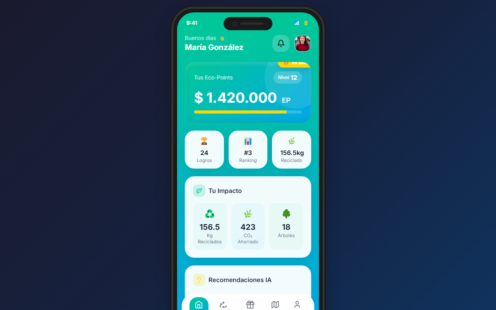

# 📱 Verde Marga Marga · Mockup móvil

[](https://github.com/Fernandamv96/-verde-marga-marga-mobile/actions/workflows/ci.yml)
[](LICENSE)

Mockup interactivo de la **app móvil** de Verde Marga Marga (reciclaje con eco-puntos), presentado dentro de un marco de teléfono. Los datos son simulados.

**Demo:** <https://verde-marga-marga-mobile.vercel.app>



> Versión web: [verde-marga-marga-web](https://github.com/Fernandamv96/verde-marga-marga-web)

## ¿Qué problema resuelve?

Muestra a usuarios y evaluadores cómo se usaría la app en el teléfono (reciclar, ver el impacto y canjear premios) antes de desarrollarla de forma nativa.

## Stack

HTML + Tailwind CSS (CDN) + JavaScript plano en un solo archivo. Sin build.

## Cómo correrlo localmente

```bash
npm ci && npm start     # http://localhost:8000
npm run lint            # html-validate
```

## 🔒 Calidad y seguridad

- CI en cada push y PR: `html-validate`, además de CodeQL, Dependabot y gitleaks en pre-commit.
- Para reportar vulnerabilidades, mira [SECURITY.md](SECURITY.md).

## 💡 Qué aprendí

- A diseñar primero para móvil (navegación inferior, tarjetas y jerarquía de métricas).
- A limpiar el código generado por IA: se quitó un widget publicitario inyectado que abría enlaces externos sin `noopener`.

## 📄 Licencia

[MIT](LICENSE) © 2026 Fernanda (Fernandamv96)
